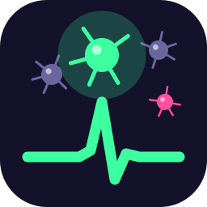
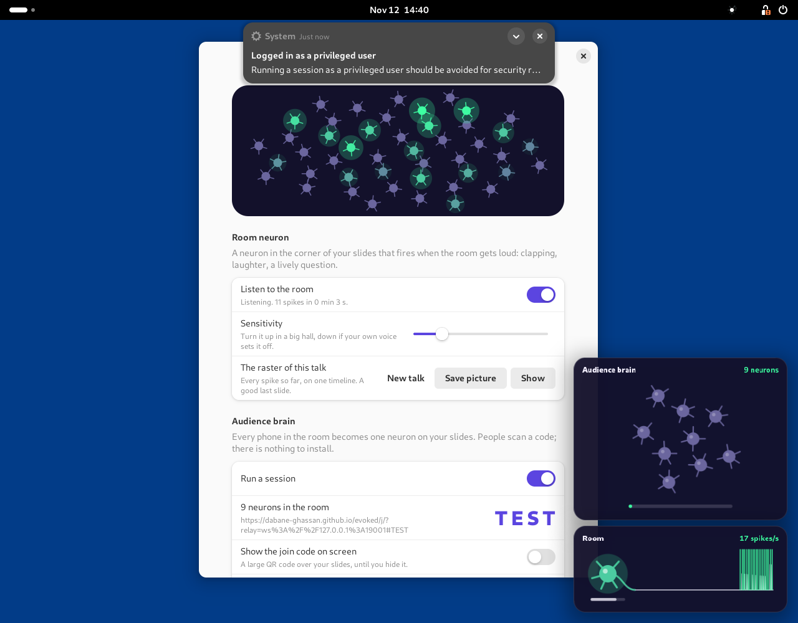
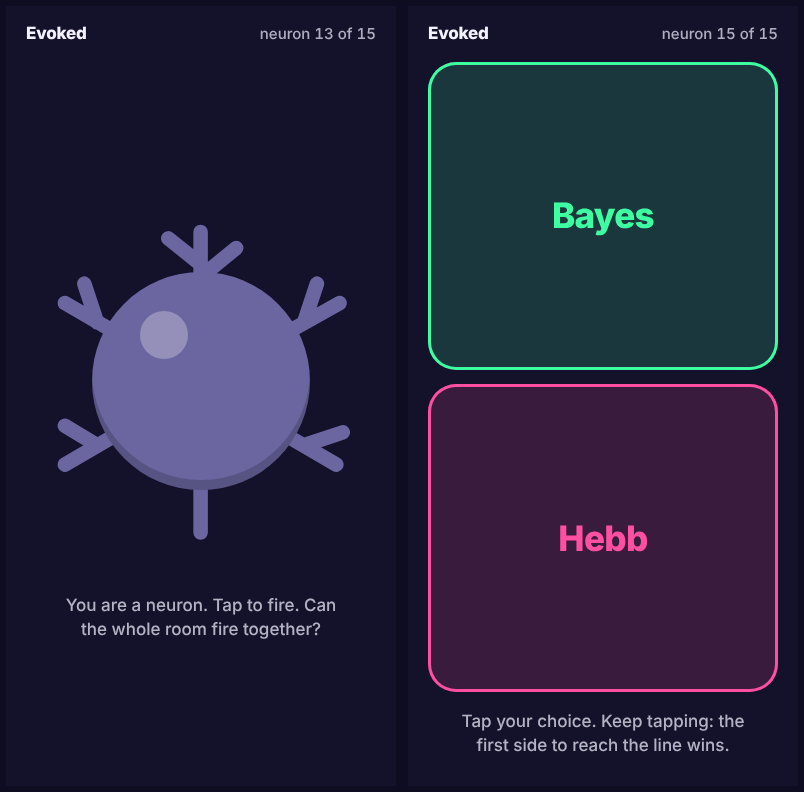
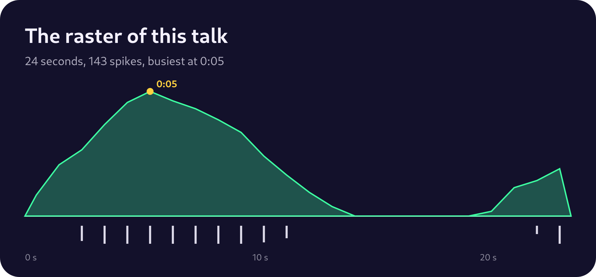

# Evoked

See what your talk evokes in the room.



Evoked draws two things over your slides, on the GNOME desktop:

- **Audience brain.** Every phone in the room becomes one neuron in a network on your screen.
  People scan a QR code; there is nothing to install and no account.
- **Room neuron.** A neuron that listens to the room and fires when it gets loud: clapping,
  laughter, a lively question. At the end you get the raster of your whole talk.

It works over any slides, fullscreen included, and never takes clicks or keys away from your
presentation.

**[Website with live demos](https://dabane-ghassan.github.io/evoked/)**

## Install

```sh
curl -fsSL https://raw.githubusercontent.com/dabane-ghassan/evoked/main/install.sh | sh
```

Then **log out and back in once** so GNOME picks it up. After that, open **Evoked** from your
apps, or click the neuron in the top bar.

It works on any distro with the GNOME desktop, version 45 or later (Fedora 39+, Ubuntu 24.04+,
Debian 13, Arch). Nothing needs root: everything goes under `~/.local`. The room neuron uses
`gst-launch-1.0` to hear the microphone; it is installed by default on Fedora Workstation and
Ubuntu, and the installer tells you if it is missing.

To update: `evoked update`, or the Update button at the bottom of the app, then log out and
back in. To remove: run the install line with `sh -s -- --remove` at the end.

## Audience brain

| | |
|---|---|
| **Ctrl+Alt+B** | Start or end a session |
| **Ctrl+Alt+J** | Show or hide the join code |
| **Ctrl+Alt+W** | Send a wave |

Starting a session puts a large QR code over your slides, with a four-letter code underneath
for anyone who would rather type. Hide it when people are in, and a network appears in the
corner of the screen: one neuron per phone.



Three things the room can do. Switch between them in the app or from the top-bar menu.

- **Free firing.** Every tap is a spike of that person's neuron. A bar under the network shows
  how much of the room fired within the same quarter of a second. When seven in ten do, the
  network rings: the room is in sync. Getting there takes a surprising amount of listening to
  each other, which is the point.
- **Wave.** You send a wave and the phones light up one after another, in the order people
  joined. Hold them up and a travelling wave crosses the room.
- **Vote.** Two choices race to a threshold. Each tap adds evidence for its side, evidence
  leaks away if nobody pushes, and the first side to reach the line wins. It is a
  drift-to-bound decision made by the audience. Name the two choices in the app.

### How the phones connect

Phones cannot reach a laptop directly on most university and conference networks, so both
sides meet on a **relay server** on the internet (MQTT over WebSocket). By default that is the
public broker `broker.emqx.io`.

- What travels through it: a random id made up by the phone, and "tapped" with which button.
  From your side: the mode, the two vote labels, and who sits where.
- Anyone who knows the four-letter code can join and tap. There is no moderation; it is a toy
  for a room of people you can see.
- It depends on that public service being up. If you would rather not, run your own
  (mosquitto with a WebSocket listener is enough) and put its address in the app under
  Connection. The join link then carries your relay's address to the phones.

## Room neuron

| | |
|---|---|
| **Ctrl+Alt+R** | Room neuron on or off |
| **Ctrl+Alt+E** | Show or hide the raster of the talk |

The microphone's loudness drives a leaky integrate-and-fire neuron (membrane time constant
60 ms, 50 ms refractory period, so it tops out near 16 spikes a second). A slow baseline tracks
the sound level, rising over about six seconds and falling over about one and a half, and only
what stands 4 dB above it gets through. So a voice at steady volume fades into the baseline,
and applause, laughter or a sudden question make it fire. Sensitivity is in the app.

It responds to any sound, yours included: if you raise your voice suddenly, it will fire.



**The raster of this talk** shows every spike since you started listening on one timeline,
with the three busiest moments marked. Show it as your last slide, or save it as a picture
(`~/Pictures/Evoked/`). "New talk" starts the count again.

Only loudness is measured, on your computer. No audio is recorded, kept or sent anywhere.

## Automation

```sh
evoked brain on            # room, brain, join, raster: on | off | toggle
evoked mode vote           # free | wave | vote
evoked wave
evoked save                # save the raster, print the path
evoked state               # JSON
```

Links work too, for clickers and launchers: `xdg-open evoked://wave`. The same is on D-Bus:
`org.gnome.Shell`, object `/io/github/dabane_ghassan/Evoked`, with a `StateChanged` signal.

## How it is built, and its limits

Like its sibling [Manicule](https://github.com/dabane-ghassan/manicule), Evoked is an app with
two parts: an ordinary window, command and installer, and a GNOME Shell extension that does the
drawing, because on Wayland only the shell may draw over every window. That is why it is GNOME
only and needs one log-out after installing.

- **Tested on GNOME 46, 49, 50 and 51** with the end-to-end suite in [`tests/`](tests/): a real
  headless GNOME Shell, a scripted microphone, twelve simulated phones on a local relay, and
  the real join page in headless Chrome. Versions 45, 47 and 48 are declared but not run.
- **Not tested, because it needs a room:** a real microphone, real phones on real networks,
  and the public relay. Try it with a friend's phone before your talk.
- The join page is hosted on this repository's GitHub Pages. If you fork it, change the join
  page address in the app.
- Waves rely on each phone's own timing after one message, so on a slow network they are
  ragged.

## Develop

```sh
make install    # install for your user from this checkout
make test       # end-to-end tests in a headless GNOME Shell
make dist       # dist/evoked.tar.gz and evoked.shell-extension.zip
make assets     # rebuild the logo and the website's shared files
```

The website and the join page live in [`docs/`](docs/). The join page and the app share one
small protocol file, [`extension/lib/mqtt-core.js`](extension/lib/mqtt-core.js).

## License

MIT. See [LICENSE](LICENSE).
